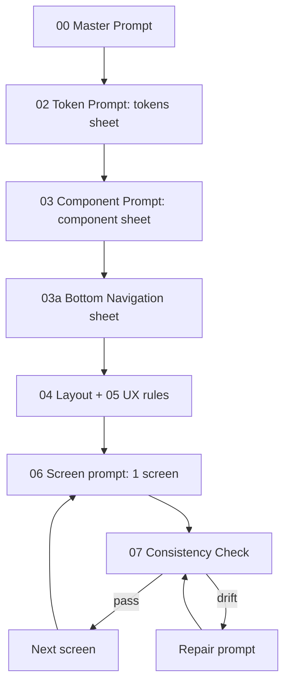

# RiceGuardian AI — UI Prompt System cho Google Stitch

Bộ prompt để **thiết kế lại đồng bộ** toàn bộ giao diện App nông dân (Flutter, `app/`) trên Google Stitch, theo Material Design 3 và 6 nguyên tắc UI/UX: Simplicity, Structure, Consistency, Feedback, Error Prevention, Familiarity.

- Prompt viết bằng **tiếng Anh**; **chữ trên UI là tiếng Việt** (lấy từ `app/lib/screens/**`).
- Token khớp [`lib/config/app_colors.dart`](../../lib/config/app_colors.dart) và [`lib/config/app_theme.dart`](../../lib/config/app_theme.dart).
- Chỉ phục vụ thiết kế; không đổi route, API hay nghiệp vụ.

## Cấu trúc

```text
app/docs/stitch/
├── README.md                 ← bạn đang ở đây (workflow)
├── 00_MASTER_PROMPT.md       ← DÁN ĐẦU TIÊN
├── 01_PRODUCT_CONTEXT.md     (tham khảo)
├── 02_DESIGN_TOKENS.md       ← Token Prompt
├── 03_COMPONENT_LIBRARY.md   ← Component Prompt
├── 03a_BOTTOM_NAV.md         ← Prompt riêng cho thanh menu footer
├── 04_LAYOUT_RULES.md        ← Layout Prompt (4 page template)
├── 05_UX_RULES.md            ← UX Prompt
├── 06_screens/               ← 1 file = 1 màn
│   └── _SCREEN_TEMPLATE.md
├── 07_CONSISTENCY_CHECK.md   ← checklist + Repair prompt
└── FLUTTER_HANDOFF.md        (chuyển sang Flutter)
```

| # | Thành phần | File | Dán vào Stitch? |
|---|---|---|---|
| 1 | Product Context | [01_PRODUCT_CONTEXT.md](01_PRODUCT_CONTEXT.md) (tóm tắt trong Master) | Không (đã có trong Master) |
| 2 | Design System | [00_MASTER_PROMPT.md](00_MASTER_PROMPT.md) + [02_DESIGN_TOKENS.md](02_DESIGN_TOKENS.md) | Có |
| 3 | Layout System | [04_LAYOUT_RULES.md](04_LAYOUT_RULES.md) | Có |
| 4 | Component Library | [03_COMPONENT_LIBRARY.md](03_COMPONENT_LIBRARY.md) + [03a_BOTTOM_NAV.md](03a_BOTTOM_NAV.md) | Có |
| 5 | UX Rules | [05_UX_RULES.md](05_UX_RULES.md) | Có |
| 6 | Screen Specification | [06_screens/](06_screens/) | Có, từng màn |
| 7 | Consistency Rules | Mục 9 của Master + [07_CONSISTENCY_CHECK.md](07_CONSISTENCY_CHECK.md) | Checklist tự rà + Repair prompt khi lệch |

## Workflow



1. Tạo **một project** Stitch, chế độ **Mobile / App**, Light. (Tùy chọn) đính kèm ảnh tham chiếu liệt kê cuối [00_MASTER_PROMPT.md](00_MASTER_PROMPT.md).
2. Dán lần lượt: **00 → 02 → 03 → 03a → 04 → 05**. Mỗi bước để Stitch sinh màn tổng hợp (Style overview, Design Tokens, Component Library, Bottom Navigation); chỉnh đến khi ưng.
3. Sinh **B1 Trang chủ** trước tiên trong các màn nghiệp vụ — đây là **màn tham chiếu**; mọi prompt màn khác đều ghi *"Reference screen for style: Trang chủ"*.
4. Sinh các màn còn lại, **mỗi lần 1 file**, theo thứ tự bên dưới.
5. Sau mỗi màn: rà [07_CONSISTENCY_CHECK.md](07_CONSISTENCY_CHECK.md). Lệch → dán **Repair prompt** trên chính màn đó (không tạo project mới).
6. Xong toàn bộ → export và làm theo [FLUTTER_HANDOFF.md](FLUTTER_HANDOFF.md).

> Đừng làm kiểu "Prompt Login → Generate, Prompt Home → Generate…" mà bỏ qua bước 2: AI sẽ tạo nhiều màn đẹp nhưng trông như nhiều app khác nhau.

## Thứ tự sinh màn hình

| Bước | File | Route | Template |
|---|---|---|---|
| 1 | [B1_home.md](06_screens/B1_home.md) — **tham chiếu** | `/home` | TAB_PAGE |
| 2 | [A1_splash.md](06_screens/A1_splash.md) | `/splash` | AUTH_PAGE |
| 3 | [A2_login.md](06_screens/A2_login.md) | `/login` | AUTH_PAGE |
| 4 | [A3_register.md](06_screens/A3_register.md) | `/register` | AUTH_PAGE |
| 5 | [A4_forgot_password.md](06_screens/A4_forgot_password.md) | `/forgot-password` | AUTH_PAGE |
| 6 | [A5_reset_password.md](06_screens/A5_reset_password.md) | `/reset-password` | AUTH_PAGE |
| 7 | [B2_fields.md](06_screens/B2_fields.md) | `/fields` | TAB_PAGE |
| 8 | [B3_camera.md](06_screens/B3_camera.md) | `/camera` | TAB_PAGE |
| 9 | [B4_alerts.md](06_screens/B4_alerts.md) | `/alerts` | TAB_PAGE |
| 10 | [B5_profile.md](06_screens/B5_profile.md) | `/profile` | TAB_PAGE |
| 11 | [C1_field_detail.md](06_screens/C1_field_detail.md) | `/fields/:id` | DETAIL_PAGE |
| 12 | [C2_ai_result.md](06_screens/C2_ai_result.md) | `/camera/preview` | DETAIL_PAGE |
| 13 | [C3_photo_history.md](06_screens/C3_photo_history.md) | `/photos` | DETAIL_PAGE |
| 14 | [C4_notifications.md](06_screens/C4_notifications.md) | `/notifications` | DETAIL_PAGE |
| 15 | [C5_settings.md](06_screens/C5_settings.md) | `/settings` | DETAIL_PAGE |
| 16 | [D1_news_list.md](06_screens/D1_news_list.md) | `/news` | DETAIL_PAGE |
| 17 | [D2_article_detail.md](06_screens/D2_article_detail.md) | `/news/:id` | DETAIL_PAGE |
| 18 | [D3_product.md](06_screens/D3_product.md) | `/product` | DETAIL_PAGE |
| 19 | [D4_my_questions.md](06_screens/D4_my_questions.md) | `/my-questions` | DETAIL_PAGE |
| 20 | [D5_question_thread.md](06_screens/D5_question_thread.md) | `/my-questions/:id` | DETAIL_PAGE |
| 21 | [E1_change_password_sheet.md](06_screens/E1_change_password_sheet.md) | sheet trên `/profile` | SHEET |
| 22 | [E2_field_log_sheet.md](06_screens/E2_field_log_sheet.md) | sheet trên `/fields/:id` | SHEET |
| 23 | [E3_logout_dialog.md](06_screens/E3_logout_dialog.md) | dialog trên `/profile` | SHEET (dialog) |

Sheet phụ sinh kèm màn cha: chi tiết ảnh (C3), hướng dẫn bệnh (B4), đặt câu hỏi (D2), chi tiết thông báo (C4).

## Màn hình mới

Copy [06_screens/_SCREEN_TEMPLATE.md](06_screens/_SCREEN_TEMPLATE.md), điền nội dung, chỉ dùng component trong [03_COMPONENT_LIBRARY.md](03_COMPONENT_LIBRARY.md). Nếu thật sự cần component mới: bổ sung vào 03 trước, sinh lại Component Library sheet, rồi mới dùng.

## Ký hiệu

- `-` : số liệu hệ thống chưa có (app UI-only/offline).
- `(proposed)` : đề xuất UI mới chưa có trong app — xem bảng cuối [FLUTTER_HANDOFF.md](FLUTTER_HANDOFF.md).
